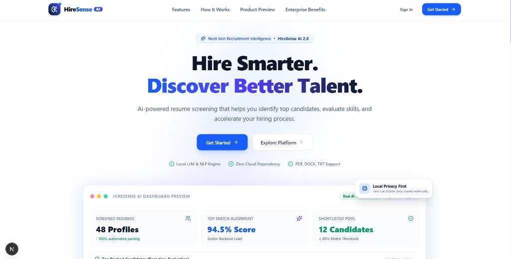
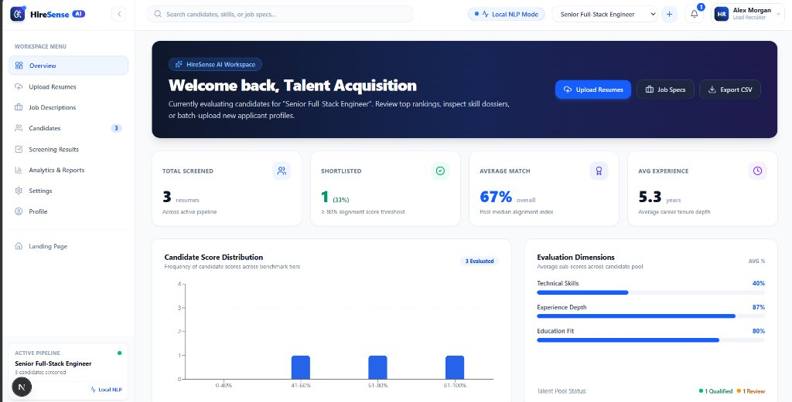
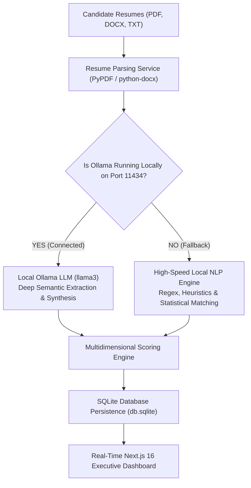

<div align="center">

# 🧠 HireSense AI

### Next-Generation AI Candidate Screening & Intelligent Talent Ranking Platform

[](https://nextjs.org/)
[](https://react.dev/)
[](https://fastapi.tiangolo.com/)
[](https://tailwindcss.com/)
[](https://python.org/)
[](https://github.com/)

<p align="center">
  <b>Hire Smarter. Discover Better Talent.</b><br/>
  An enterprise-grade talent screening and applicant prioritization SaaS platform powered by a Dual-AI Engine.<br/>
  Automate resume parsing, evaluate dimensional skill alignment, and rank candidates instantly.
</p>

[🌟 Highlights](#-platform-highlights) • [🖥️ Screenshots](#️-platform-previews) • [⚙️ Dual AI Engine](#-dual-ai-engine-architecture) • [📊 Scoring Methodology](#-scoring-methodology) • [🏗️ Architecture](#️-project-architecture) • [🚀 Quick Start](#-quick-start) • [🔒 Privacy](#-local-first-security--privacy)

---

</div>

## 🖥️ Platform Previews

### 1. High-Converting SaaS Landing Page
> Built with modern typography, subtle gradients, product showcase preview, feature cards, and 1-click workspace launch.

<div align="center">
  
</div>

<br/>

### 2. Executive ATS Screening Dashboard
> Real-time recruitment workspace with pipeline health, score distribution histograms, dimensional competency radar, candidate leaderboard, and 1-click demo resume evaluation.

<div align="center">
  
</div>

---

## 🌟 Platform Highlights

| Capability | Description |
|---|---|
| **⚡ Dual AI Screening Engine** | Seamlessly alternates between local **Ollama LLM** (`llama3`) and zero-dependency **High-Speed NLP Heuristics** (`< 250ms`). |
| **📄 Multi-Format Ingestion** | Batch drag-and-drop support for `.pdf`, `.docx`, `.doc`, and `.txt` resumes with real-time progress indicators. |
| **🎯 Multidimensional Scoring** | Transparent alignment calculation across **Technical Fit (50%)**, **Experience Depth (30%)**, and **Education Pedigree (20%)**. |
| **🏆 Interactive Leaderboards** | Real-time candidate ranking with table and card view toggles, skill filtering, status tags (`Shortlisted`, `Under Review`, `Low Match`), and CSV exports. |
| **🔍 Comprehensive Dossiers** | Slide-over candidate inspection drawers displaying AI screening verdicts, verified skills, and chronological career timelines. |
| **⚖️ Head-to-Head Comparison** | Side-by-side comparison matrix for up to 3 candidates simultaneously highlighting best-in-class qualifications. |
| **📊 Talent Analytics & Funnel** | Executive recruitment intelligence tracking hiring funnel conversion rates, score distributions, and skill demand frequency. |
| **🧪 1-Click Demo Testing** | Pre-bundled test profiles for instant evaluation without searching for sample files. |

---

## ⚙️ Dual AI Engine Architecture

HireSense AI is designed with a **privacy-first dual-engine** mechanism that balances depth of semantic understanding with instantaneous processing velocity:



1. **Local Ollama LLM Mode**: When Ollama is running locally, resumes are evaluated with semantic language models for deep context extraction.
2. **High-Speed Local NLP Mode**: When running standalone, HireSense AI uses optimized regex, dictionary matching, and statistical heuristics to extract skills and compute fit in under 250 milliseconds with zero external setup.

---

## 📊 Scoring Methodology

Every applicant profile is evaluated objectively against the active job specification criteria using standard dimensional weights:

| Dimension | Default Weight | Evaluation Focus |
|---|:---:|---|
| **Technical Competency** | **50%** | Overlap between candidate verified skills and required job benchmarks. |
| **Experience Tenure** | **30%** | Verified professional career duration vs role seniority requirements. |
| **Education Pedigree** | **20%** | Degree tier match (Master's, Bachelor's, Associate's, Certifications). |

### Candidate Classification Tiers
- 🟢 **Shortlisted (Score ≥ 80%)**: Strong candidate meeting or exceeding all core role criteria.
- 🟡 **Under Review (Score 50% – 79%)**: Relevant profile with adjacent competencies or lower tenure.
- ⚪ **Low Match (Score < 50%)**: Missing primary required frameworks or experience benchmarks.

---

## 📁 Project Architecture

```
HireSense/
├── backend/                             # FastAPI Python 3.10+ Backend
│   ├── app/
│   │   ├── main.py                      # REST API routes and endpoints
│   │   ├── database.py                  # SQLite database persistence & models
│   │   ├── models/
│   │   │   └── schemas.py               # Pydantic schemas (Jobs, Candidates, Compare)
│   │   └── services/
│   │       ├── extractor.py             # Dual engine (LLM extractor & NLP fallback)
│   │       ├── parser.py                # Multi-format parser (PDF, DOCX, DOC, TXT)
│   │       └── scorer.py                # Multidimensional scoring algorithm
│   ├── db.sqlite                        # Local persistent database
│   └── requirements.txt                 # Backend Python dependencies
│
├── frontend/                            # Next.js 16 / React 19 Frontend
│   ├── app/
│   │   ├── components/                  # Modular SaaS UI Components
│   │   │   ├── landing-page.tsx         # High-converting modern SaaS landing page
│   │   │   ├── dashboard.tsx            # Main workspace coordinator & state
│   │   │   ├── sidebar.tsx              # Collapsible sidebar with active status
│   │   │   ├── topbar.tsx               # Global search, notifications & profile
│   │   │   ├── dashboard-overview.tsx   # KPI cards, score charts & dimensions
│   │   │   ├── upload-zone.tsx          # Drag-and-drop batch resume upload
│   │   │   ├── job-input.tsx            # Job specification manager & presets
│   │   │   ├── leaderboard.tsx          # Ranked table/cards & comparison launcher
│   │   │   ├── candidate-detail.tsx     # Slide-over candidate dossier & raw text
│   │   │   ├── comparison-matrix.tsx    # Head-to-head candidate comparison modal
│   │   │   ├── analytics-view.tsx       # Recruitment funnel & score distribution
│   │   │   ├── settings-view.tsx        # Criteria weights, profile & diagnostics
│   │   │   ├── logo.tsx                 # HireSense AI vector brand badge
│   │   │   └── toast.tsx                # Floating micro-toast notifications
│   │   ├── layout.tsx                   # Font definitions, light theme & SEO
│   │   ├── page.tsx                     # Root page entrypoint
│   │   ├── types.ts                     # TypeScript data interfaces
│   │   ├── config.ts                    # API base configuration
│   │   └── globals.css                  # Tailwind CSS v4 design system
│   ├── next.config.ts                   # Next.js configuration & Turbopack roots
│   └── package.json                     # Frontend dependencies
│
├── test_resumes/                        # Pre-bundled sample candidate resumes
│   ├── Alex_Rivera_Data_Scientist.txt   # Sample Data Scientist profile (71.4% match)
│   ├── Jane_Smith_Junior_Frontend.txt   # Sample Junior Frontend profile (41.5% match)
│   └── John_Doe_Senior_Backend.txt      # Sample Senior Backend profile (86.9% match)
│
├── docs/                                # Documentation and assets
│   └── images/                          # High-resolution screenshots
└── run.sh                               # Dual-service concurrent launch script
```

---

## 🚀 Quick Start

### Prerequisites
- **Python 3.10+**
- **Node.js 18+** and **npm**
- *(Optional)* **Ollama** with `llama3` for full local LLM extraction (`ollama run llama3`).

---

### Method 1: Concurrent Launcher (Recommended)
On Linux, macOS, or Git Bash on Windows:
```bash
chmod +x run.sh
./run.sh
```

---

### Method 2: Manual Step-by-Step Launch

#### 1. Backend Service (FastAPI)
```powershell
# Open Terminal 1
cd HireSense\backend

# Activate virtual environment
# Windows:
.\venv\Scripts\activate
# Linux/macOS:
# source venv/bin/activate

# Install dependencies (first time only)
pip install -r requirements.txt

# Start FastAPI server on port 8000
python -m uvicorn app.main:app --host 127.0.0.1 --port 8000 --reload
```
*Backend API will be running at [http://127.0.0.1:8000](http://127.0.0.1:8000)*  
*Interactive Swagger Documentation: [http://127.0.0.1:8000/docs](http://127.0.0.1:8000/docs)*

#### 2. Frontend Application (Next.js 16)
```powershell
# Open Terminal 2
cd HireSense\frontend

# Install dependencies (first time only)
npm install

# Start Next.js development server
npm run dev
```
*Web Application will be running at [http://localhost:3000](http://localhost:3000)*

---

## 🔌 API Reference Summary

| Endpoint | Method | Description |
|---|:---:|---|
| `/api/health` | `GET` | Health status and active AI Engine state (`ollama` or `fallback_mode`). |
| `/api/jobs` | `GET` | List all existing screening pipelines and extracted requirements. |
| `/api/jobs` | `POST` | Create a new job specification and auto-extract requirement tags. |
| `/api/jobs/{id}` | `GET` | Retrieve details for a specific job pipeline. |
| `/api/jobs/{id}` | `DELETE` | Delete a pipeline and all associated candidate screening data. |
| `/api/jobs/{id}/resumes` | `POST` | Ingest and screen a batch of resume files (`multipart/form-data`). |
| `/api/jobs/{id}/candidates` | `GET` | Retrieve all screened candidates ranked by score descending. |
| `/api/candidates/{id}` | `GET` | Inspect full candidate dossier including breakdown scores and raw text. |
| `/api/jobs/{id}/compare` | `GET` | Head-to-head comparison grid for comma-separated candidate IDs (`?ids=1,2,3`). |

---

## 🔒 Local-First Security & Privacy

In an era of confidential applicant records and strict data compliance regulations (GDPR, CCPA), **HireSense AI is architected from the ground up to be 100% local-first**:

- 🛡️ **Zero Cloud Exposure**: Resumes and candidate personally identifiable information (PII) are processed entirely on your local machine. No applicant data is transmitted to commercial third-party cloud APIs.
- 💾 **Local Persistence**: All candidate records and scores are stored in a local SQLite file (`db.sqlite`) under your direct custody.
- 🧹 **Ephemeral Ingestion**: Extracted resume byte streams are cleared from RAM immediately following schema validation.

---

## 📄 License

This project is licensed under the MIT License — see the [LICENSE](LICENSE) file for details.

<div align="center">
  <sub>Engineered with precision for modern technical recruitment and talent acquisition teams.</sub>
</div>
